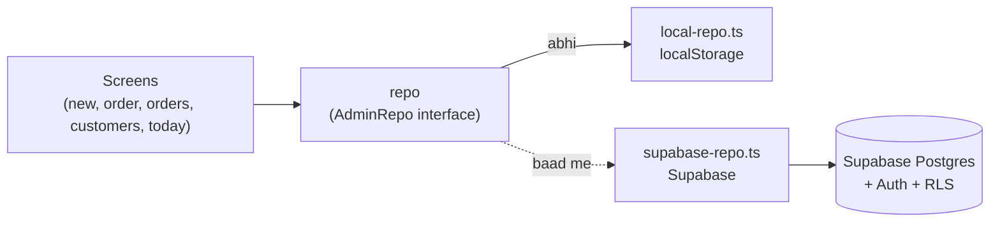
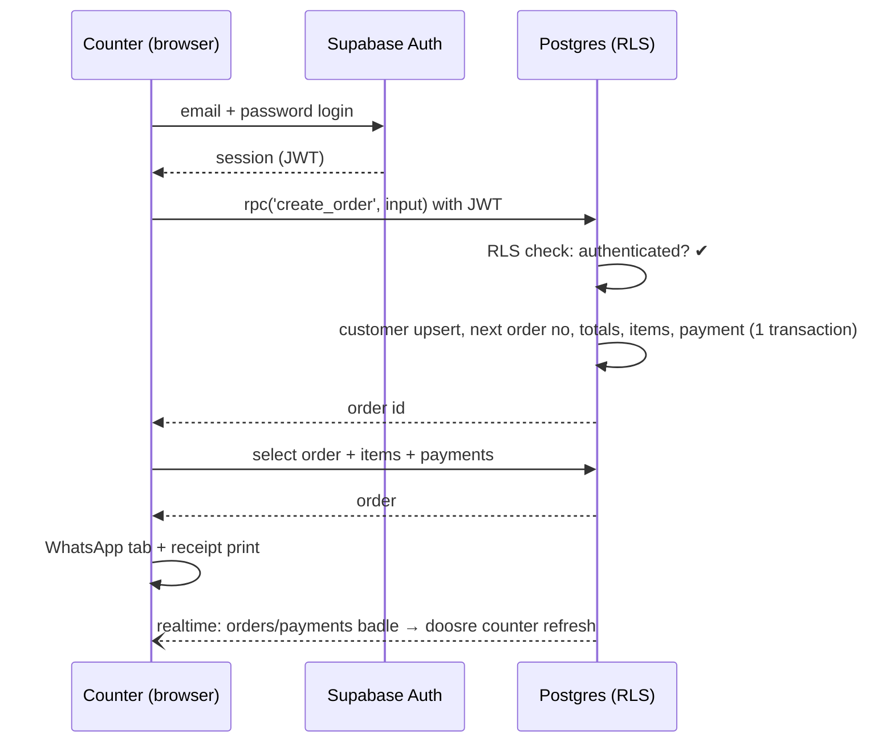

# EcoSpin Counter (Admin Panel)

Counter par baithne wale staff ke liye panel: order lena, bill print karna, customer ko WhatsApp bhejna, aur kapdon ka status track karna.

URL: `/admin` (website ke saath hi deploy hota hai, Google me index nahi hota).

> **Abhi data kahan save ho raha hai?** Sirf usi browser me (localStorage). Matlab ek computer ka data doosre computer par nahi dikhega, aur browser data clear karne par mit jayega. Real use se pehle Supabase connect karna zaroori hai (neeche Step-by-step diya hai).

---

## 1. Screens

| URL | Kaam |
|---|---|
| `/admin` | **Today**: aaj ke orders, aaj ka collection (Cash/UPI/Card), overdue, due today, ready orders, pending dues |
| `/admin/new` | **New order**: mobile, naam, address → neeche kapdon ka menu, tap karke add → Save |
| `/admin/order?id=…` | Order detail: status badlo, payment lo, WhatsApp bhejo, receipt print karo |
| `/admin/orders` | Saare orders, status filter aur search (order no / naam / mobile) |
| `/admin/customers` | Customers, unke orders, total kharcha, dues |

Upar **Thane / Kharghar** switch hai. Jo store chuna hai, orders usi store ke bante aur dikhte hain (customers dono stores ke common hain).

### New order ka flow

```
Mobile number type karo ──► purana customer hai? naam + address khud bhar jayega
        │
        ▼
Menu se kapde tap karo (Gentlemen / Ladies / Household / Other item)
  • Dry clean ↔ Press only switch
  • Search box se kisi bhi item ko dhundho
  • Bill me − / + se qty, aur har item par colour/brand/damage note
        │
        ▼
Speed (Regular / Next day +50% / Same day +100%), Packing, Discount, Paid now
        │
        ▼
[ Save order ]
  1. Order save hota hai, order no. milta hai (TH-0001 / KH-0001)
  2. Naye tab me WhatsApp khulta hai, customer ko bill ka message tayaar — staff Send dabata hai
  3. Order page khulta hai aur receipt ka print dialog apne aap aata hai
```

### Order status

```
Received ──► In process ──► Ready ──► Delivered
                              │
                              └─ "Mark ready & tell customer" = status + WhatsApp "kapde ready hain"
(Cancel kisi bhi open order par)
```

---

## 2. Code ka architecture

```
src/
├── app/
│   ├── (site)/               ← public website (URLs same: /, /pricing, /book …)
│   │   └── layout.tsx        ← website ka header, footer, intro animation
│   ├── admin/                ← counter panel (apna layout, website ka kuch load nahi hota)
│   │   ├── layout.tsx
│   │   ├── admin.css         ← receipt + print styles (80 mm thermal)
│   │   ├── page.tsx          ← Today
│   │   ├── new/page.tsx      ← New order
│   │   ├── order/page.tsx    ← Order detail + receipt
│   │   ├── orders/page.tsx
│   │   └── customers/page.tsx
│   └── layout.tsx            ← sirf <html>, fonts, globals
├── admin/
│   ├── types.ts              ← Order, Customer, Payment … (DB ke shapes)
│   ├── config.ts             ← hanger charge, WhatsApp mode, receipt terms, auto print
│   ├── hooks.tsx             ← store switch + useRepoQuery (data load & auto refresh)
│   ├── data/
│   │   ├── repo.ts           ← AdminRepo interface — screens sirf isko call karti hain
│   │   ├── local-repo.ts     ← abhi wala: browser storage
│   │   └── index.ts          ← ★ YAHAN EK LINE BADAL KE SUPABASE LAGEGA
│   ├── lib/
│   │   ├── calc.ts           ← total, express, hanger, due date (Friday skip)
│   │   └── whatsapp.ts       ← messages + bhejne ka tareeka
│   └── components/           ← Receipt, AdminShell, OrderRow, StatusBadge
└── data/site.ts              ← price list (website + counter dono yahi use karte hain)

supabase/schema.sql           ← poora database ek baar me banane ki SQL
```

### Sabse important rule

Koi bhi screen seedha database ko touch nahi karti. Sab `repo` ke through jata hai:



Isliye Supabase lagane par **koi screen nahi badlegi**: sirf ek nayi file (`supabase-repo.ts`) banegi aur `data/index.ts` me ek line badlegi.

`AdminRepo` ke functions:

| Function | Kaam |
|---|---|
| `listOrders(filter)` | store, status (`open` = delivered/cancelled ke alawa), search, customerId |
| `getOrder(id)` | ek order with items, payments, history |
| `createOrder(input)` | customer upsert (phone se) + order no. + items + advance payment |
| `setStatus(id, status)` | status badlo, history me entry |
| `addPayment(id, amount, mode)` | payment jodo, balance update |
| `findCustomerByPhone(phone)` | purana customer auto-fill |
| `listCustomers(search)` | orders, spent, due ke saath |
| `subscribe(cb)` | data badle to khuli screens refresh ho |

---

## 3. Supabase connect karna (step by step)

### Flow (connect hone ke baad)



Totals aur order number **database khud nikalta hai** (`create_order` function), browser par bharosa nahi kiya jata.

### Step 1 — Project banao
1. [supabase.com](https://supabase.com) → New project (region: **Mumbai / ap-south-1**).
2. **SQL Editor** → New query → `supabase/schema.sql` paste → **Run**.
3. **Authentication → Providers → Email**: ON. **Authentication → Settings**: "Allow new users to sign up" **OFF** (taaki koi bahar wala account na bana sake).
4. **Authentication → Users → Add user**: counter ke liye email + password banao (jaise `thane@ecospindrycleaners.com`).

### Step 2 — Keys
**Project Settings → API** se copy karo aur repo ke root me `.env.local` banao (Vercel par bhi yahi Environment Variables me daalna):

```bash
NEXT_PUBLIC_SUPABASE_URL=https://xxxx.supabase.co
NEXT_PUBLIC_SUPABASE_ANON_KEY=eyJ...
```

`anon` key public hoti hai, browser me rehna theek hai. Data RLS se surakshit hai: bina login koi kuch nahi padh sakta. **`service_role` key kabhi bhi frontend me mat daalna.**

### Step 3 — Library
```bash
npm install @supabase/supabase-js
```

### Step 4 — `src/admin/data/supabase.ts`
```ts
import { createClient } from "@supabase/supabase-js";

export const supabase = createClient(
  process.env.NEXT_PUBLIC_SUPABASE_URL!,
  process.env.NEXT_PUBLIC_SUPABASE_ANON_KEY!,
);
```

### Step 5 — `src/admin/data/supabase-repo.ts`
DB ke snake_case columns ko app ke camelCase types me badalta hai:

```ts
import { adminConfig } from "../config";
import type { Customer, Order } from "../types";
import type { AdminRepo } from "./repo";
import { supabase } from "./supabase";

const ORDER_SELECT = "*, order_items(*), payments(*), order_status_log(status, at)";

/* eslint-disable @typescript-eslint/no-explicit-any */
const toOrder = (r: any): Order => ({
  id: r.id, orderNo: r.order_no, storeSlug: r.store_slug, customerId: r.customer_id,
  customerName: r.customer_name, customerPhone: r.customer_phone, customerAddress: r.customer_address,
  items: [...r.order_items].sort((a: any, b: any) => a.position - b.position)
    .map((i: any) => ({ id: i.id, name: i.name, category: i.category, mode: i.mode, price: i.price, qty: i.qty, note: i.note })),
  pieces: r.pieces, speed: r.speed, packing: r.packing, homeDelivery: r.home_delivery,
  subtotal: r.subtotal, expressCharge: r.express_charge, hangerCharge: r.hanger_charge,
  discount: r.discount, total: r.total, paid: r.paid, balance: r.balance,
  status: r.status, note: r.note, createdAt: r.created_at, dueDate: r.due_date, deliveredAt: r.delivered_at,
  payments: [...r.payments].sort((a: any, b: any) => a.at.localeCompare(b.at))
    .map((p: any) => ({ id: p.id, amount: p.amount, mode: p.mode, at: p.at })),
  history: [...r.order_status_log].sort((a: any, b: any) => a.at.localeCompare(b.at)),
});

const toCustomer = (r: any): Customer => ({
  id: r.id, name: r.name, phone: r.phone, address: r.address, notes: r.notes, createdAt: r.created_at,
});

function check<T>(res: { data: T; error: { message: string } | null }): T {
  if (res.error) throw new Error(res.error.message);
  return res.data;
}

export const supabaseRepo: AdminRepo = {
  async listOrders(f = {}) {
    let q = supabase.from("orders").select(ORDER_SELECT).order("created_at", { ascending: false }).limit(500);
    if (f.storeSlug) q = q.eq("store_slug", f.storeSlug);
    if (f.customerId) q = q.eq("customer_id", f.customerId);
    if (f.status === "open") q = q.not("status", "in", "(delivered,cancelled)");
    else if (f.status) q = q.eq("status", f.status);
    if (f.search?.trim()) {
      const s = f.search.trim().replace(/[,()]/g, "");
      q = q.or(`order_no.ilike.%${s}%,customer_name.ilike.%${s}%,customer_phone.ilike.%${s}%`);
    }
    return check(await q).map(toOrder);
  },

  async getOrder(id) {
    const row = check(await supabase.from("orders").select(ORDER_SELECT).eq("id", id).maybeSingle());
    return row ? toOrder(row) : null;
  },

  async createOrder(input) {
    const id = check(await supabase.rpc("create_order", {
      input: { ...input, hangerChargePerPiece: adminConfig.hangerChargePerPiece },
    })) as string;
    return (await this.getOrder(id))!;
  },

  async setStatus(id, status) {
    check(await supabase.from("orders").update({ status }).eq("id", id));
    return (await this.getOrder(id))!;
  },

  async addPayment(id, amount, mode) {
    const order = await this.getOrder(id);
    const amt = Math.min(Math.round(amount), order?.balance ?? 0);
    if (amt > 0) check(await supabase.from("payments").insert({ order_id: id, amount: amt, mode }));
    return (await this.getOrder(id))!;
  },

  async findCustomerByPhone(phone) {
    const row = check(await supabase.from("customers").select("*").eq("phone", phone).maybeSingle());
    return row ? toCustomer(row) : null;
  },

  async listCustomers(search = "") {
    let q = supabase.from("customer_summary").select("*").order("last_order_at", { ascending: false, nullsFirst: false }).limit(500);
    const s = search.trim().replace(/[,()]/g, "");
    if (s) q = q.or(`name.ilike.%${s}%,phone.ilike.%${s}%`);
    return check(await q).map((r: any) => ({
      ...toCustomer(r), orders: r.orders, spent: r.spent, due: r.due, lastOrderAt: r.last_order_at,
    }));
  },

  subscribe(onChange) {
    const ch = supabase
      .channel("counter")
      .on("postgres_changes", { event: "*", schema: "public", table: "orders" }, onChange)
      .on("postgres_changes", { event: "*", schema: "public", table: "payments" }, onChange)
      .subscribe();
    return () => void supabase.removeChannel(ch);
  },
};
```

### Step 6 — Switch on
`src/admin/data/index.ts`:
```ts
export { supabaseRepo as repo } from "./supabase-repo";
```

### Step 7 — Login screen
Supabase lagne ke baad bina login data nahi aayega (RLS). `AdminShell.tsx` me session check karo:

```tsx
// AdminShell ke andar
const [session, setSession] = useState<Session | null | undefined>(undefined);
useEffect(() => {
  supabase.auth.getSession().then(({ data }) => setSession(data.session));
  const { data } = supabase.auth.onAuthStateChange((_e, s) => setSession(s));
  return () => data.subscription.unsubscribe();
}, []);
if (session === undefined) return <p>Loading…</p>;
if (!session) return <LoginForm />; // email + password → supabase.auth.signInWithPassword({ email, password })
```
Header me ek **Log out** button: `supabase.auth.signOut()`.

### Step 8 — Purana local data (optional)
Agar testing me localStorage me orders bana liye the aur unhe rakhna hai, browser console me `localStorage.getItem("ecospin-admin-v1")` se JSON nikal ke import script likh sakte hain. Fresh start karna ho to zaroorat nahi.

### Baad me jab roles chahiye (Owner / Delivery boy)
`profiles (user_id, role, store_slug)` table banao aur RLS policies me `role` check karo. Screens ka code nahi badlega.

---

## 4. WhatsApp

`src/admin/config.ts` me `whatsappMode`.

### Abhi: `"link"` (free)
Save karte hi naya tab khulta hai: `wa.me/91XXXXXXXXXX?text=…`. Counter ke computer par **WhatsApp Desktop / WhatsApp Web** me store ka number login rakho. Message tayaar milta hai, staff sirf **Send** dabata hai.

- Kharcha: ₹0
- Kamzori: ek click staff ko karna padta hai; message store ke WhatsApp number se jata hai.

Teen messages bane hue hain (`lib/whatsapp.ts` me text badal sakte ho): order ka bill, "kapde ready hain", payment reminder.

### Baad me: `"api"` (paid, fully automatic)
Message bina kisi click ke apne aap jata hai. Iske liye **official WhatsApp Business (Cloud) API** chahiye:

| Option | Kya hai |
|---|---|
| **Meta WhatsApp Cloud API** (seedha) | Sabse sasta, per-message Meta charge. Setup thoda technical: Meta Business verify, number register, templates approve |
| **BSP: Interakt, AiSensy, Wati, Gupshup** | Upar wala hi, par aasaan dashboard + Indian support. Monthly plan + per-message charge |

Zaroori baatein:
- Business ki taraf se pehla message sirf **approved template** se ja sakta hai (jaise `order_received`, `order_ready` with variables). Templates provider ke dashboard me banao.
- Jo number API par lagega, woh normal WhatsApp app me use nahi hoga. Isliye alag number lena behtar hai.

Code me kya karna hai:
1. `config.ts` → `whatsappMode: "api"`.
2. Server route `src/app/api/whatsapp/route.ts` banao. Woh `orderId` se order Supabase se padhe aur provider ki API ko template message bheje. API key sirf server env me (`WHATSAPP_API_KEY`), browser me kabhi nahi. Ya yahi kaam Supabase **Edge Function** me karo (database trigger se: status `ready` hua → message).

> **Unofficial libraries (whatsapp-web.js, Baileys) mat use karna.** Free hain, par WhatsApp aise automation par number **ban** kar deta hai, aur 24×7 server chalana padta hai.

---

## 5. Receipt printing

- Receipt **80 mm thermal printer** ke size ka hai (`admin.css` → `@page { size: 80mm auto }`). Normal A4 printer par bhi chhapega.
- Save ke baad print dialog apne aap aata hai (`config.ts` → `autoPrintOnSave`).
- Chrome me ek baar printer select karke "Margins: None" aur "Headers and footers: off" kar do; Chrome yaad rakhta hai.
- Bina dialog ke seedha print chahiye: Chrome ko `--kiosk-printing` flag ke saath chalao (counter computer ke shortcut me).
- Receipt par har kapde ka **tag number** (1, 2, 3 …) aata hai, wahi number kapde ke tag par likho.
- Terms `config.ts` → `receiptTerms` me badlo.

---

## 6. Customise karna ho to kahan

| Kya | File |
|---|---|
| Prices / items | `src/data/site.ts` → `priceList` (website bhi update hogi) |
| Hanger charge, auto print, receipt terms | `src/admin/config.ts` |
| Turnaround days, order prefix (TH/KH) | `src/data/site.ts` → `stores` |
| WhatsApp message ka text | `src/admin/lib/whatsapp.ts` |
| Receipt ka design | `src/admin/components/Receipt.tsx` |
| Naya DB field | `types.ts` + `schema.sql` + dono repo files |
